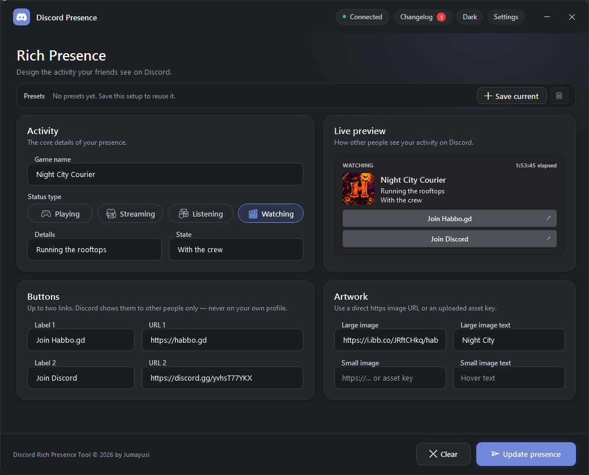
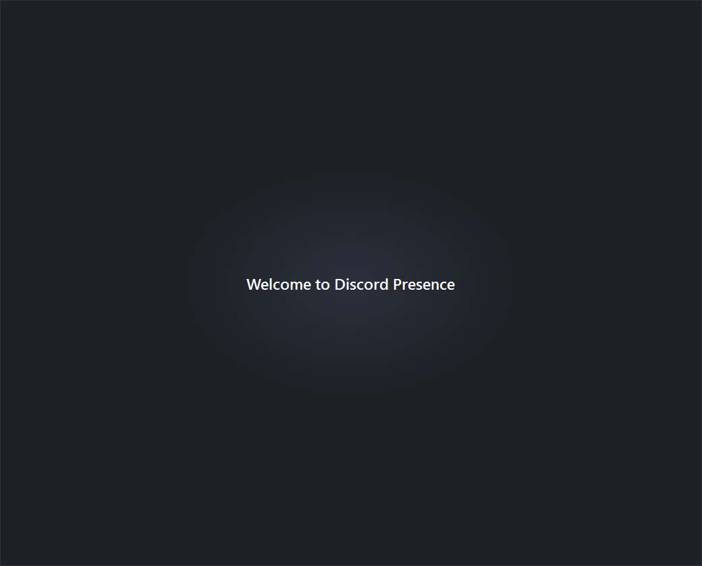
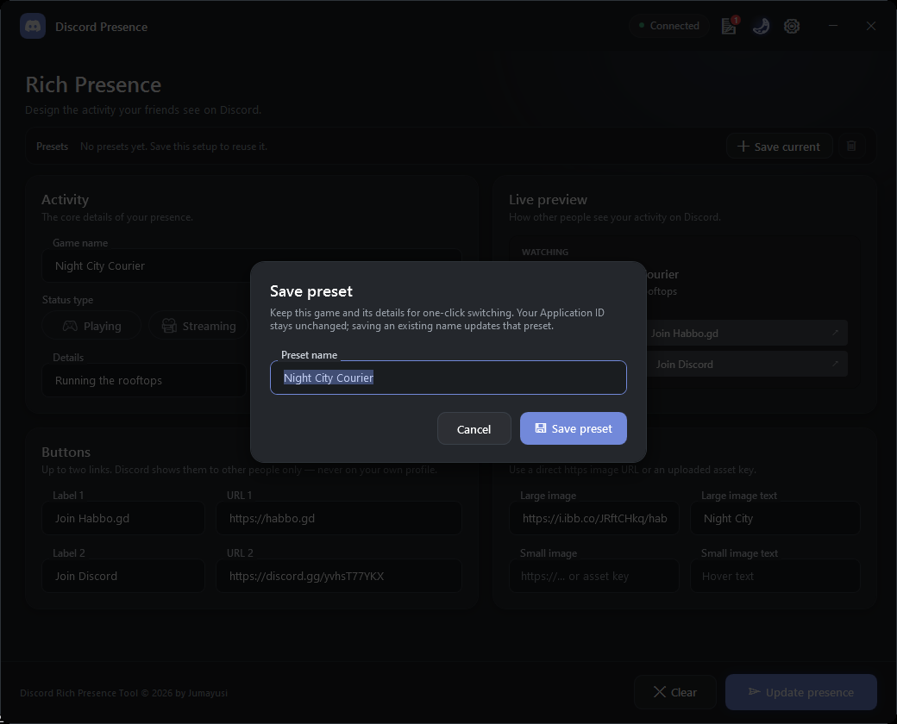
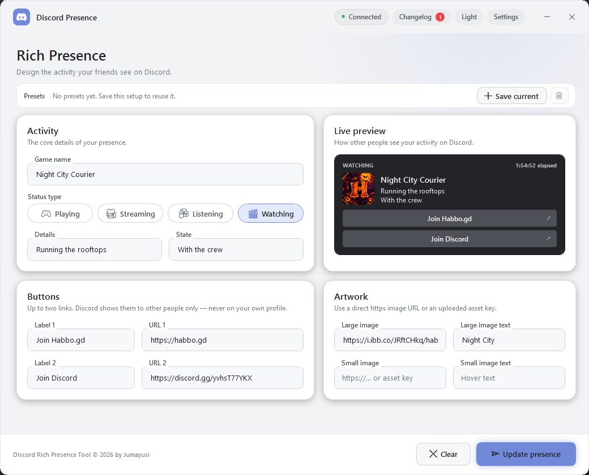
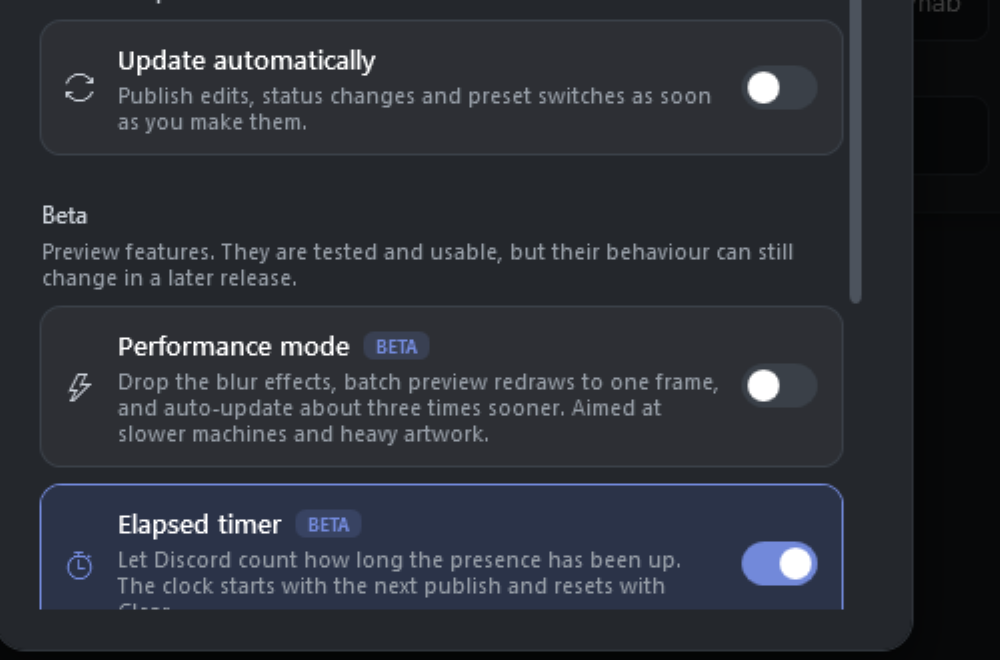
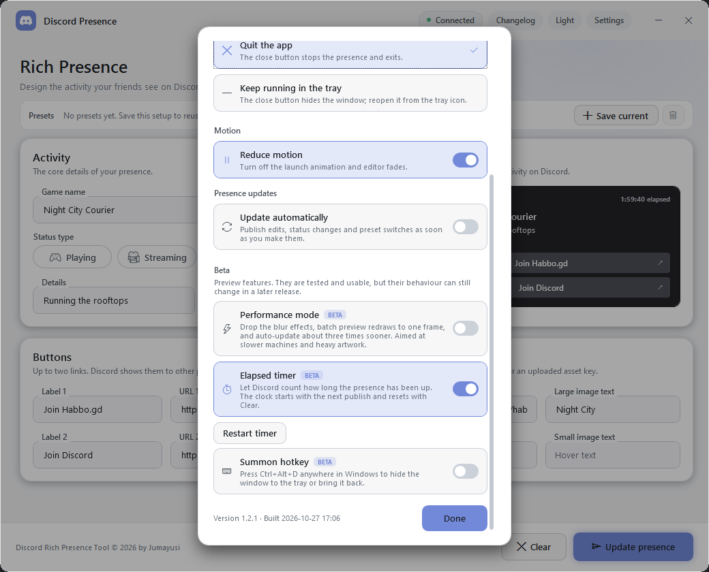
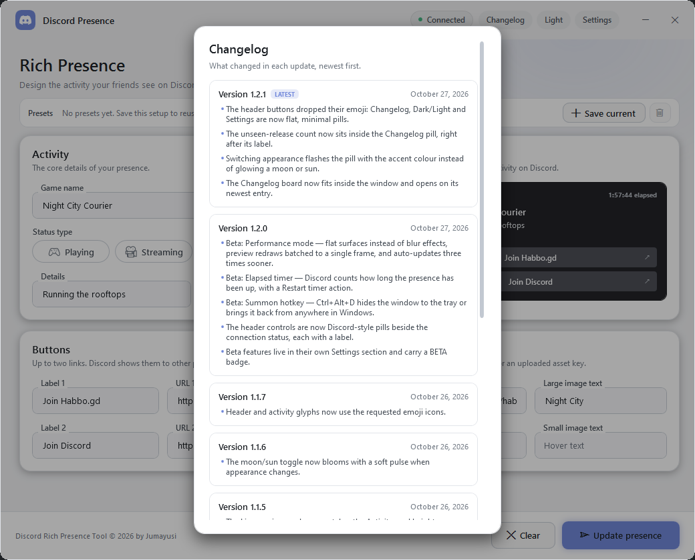

# Discord Presence

A small, portable Windows app for publishing a custom Discord Rich Presence.
One `.exe`, no installer, no account tokens, and no background service.



Dark Material interface using the requested surface `#1e2124`, accent `#7289da`,
and white primary text, with an optional light appearance. Field labels are
notched into their outlines, so each label and input reads as one control.

## Features

- Activity types: **Playing**, **Streaming**, **Listening**, and **Watching**
- Custom game/activity name, **Details**, and **State**
- Large and small artwork from a direct `https` image URL or an uploaded asset key
- Hover text for both images
- Up to two Rich Presence buttons
- **Live preview** of the activity card beside the editor, including the
  artwork and the buttons other people see
- Named presets to save and switch between different games and setups
- Optional **auto-update** mode that republishes while you edit, switch the
  activity type, or load a preset, and brings the saved presence back on launch
- Short startup animation: the Discord logo fades in and out, then a welcome
  message, before the editor appears
- Smooth content fade on restore, close and hide-to-tray, with an opaque
  window surface so the fade never flashes white or reveals the desktop
- Optional **Reduce motion** mode that skips the launch animation and all
  fades
- **Settings** for the Discord Application ID, auto-update, and close-to-tray
  behavior
- **Dark/Light** header pill for appearance, with a soft accent flash when
  switched
- Header controls shaped like Discord's connection status: flat, borderless
  pills for appearance, the changelog and settings, lined up beside the status
  chip
- Emoji glyphs on the four activity-type chips
- **Changelog** board in the header, with a Discord-style count badge for
  unseen releases
- **Beta** features in their own Settings section, each with a BETA badge:
  a performance mode, an elapsed timer and a summon hotkey
- Rounded window corners
- Automatic reconnect after Discord restarts
- **Clear** action to remove the presence
- Remembers all settings and presets between launches

## Startup sequence

On launch the window shows a full-surface welcome screen for about three
seconds: the Discord mark fades in at the center, scales up slightly, fades out,
and "Welcome to Discord Presence" fades in before the editor is revealed. The
animation runs once per launch, is skipped if the window is closing or
**Reduce motion** is on, and blocks clicks until it finishes.



## Presets

The **Presets** bar above the editor keeps a library of setups:

- **Save current** stores the game name, activity type, details, state, stream
  URL, artwork, and buttons under a name.
- Click a preset chip to load it. The active chip is checked and outlined.
  Loading a preset publishes it when **Update automatically** is on; otherwise
  click **Update presence** when you want Discord to show it.
- Saving with an existing name updates that preset instead of creating a
  duplicate. If you have edited the active preset, the dialog suggests the
  current game name so an existing setup is not overwritten by accident.
- Select a preset, then click the trash button to delete it. A confirmation is
  shown first.
- **Esc**, **Cancel**, or clicking outside the dialog closes it without saving.

Presets live in the same portable `discord-presence.json` as the rest of the
settings. The Discord **Application ID** is connection-wide and is not stored in
a preset, so switching presets never changes the application your presence is
published through.



## Live preview

**Live preview** sits in the right column of the editor. It renders the
activity card, artwork, hover text, and buttons from the current values as you
type, so the card matches what other people see on your Discord profile before
you publish. The dark Discord card stays dark in both appearance modes, just
like the real popout. Discord itself never shows the buttons on your own card.

## Appearance

The header pill reads **Dark** in dark mode (`#1e2124` surface, `#7289da`
accent, white text) and **Light** in light mode. Click it to switch instantly;
the pill picks up the accent colour and settles back to its resting tint. The
choice is saved in the portable settings file. The appearance control is kept in
the header, separate from the editor settings. **Reduce motion** skips the
flash.



## Beta features

Three optional features sit in their own **Beta** section at the bottom of
Settings, each carrying a BETA badge. They are tested and usable, but their
behaviour can still change in a later release. All three are off until you
switch them on.



- **Performance mode** drops the blur behind every card and the glow behind the
  update button, batches the live preview into one redraw per frame instead of
  one per edit, skips preview work while the window is hidden, and shortens the
  auto-update pause from 0.7 s to 0.25 s. In a
  scripted test on this machine (150 edits into the Details field, twice per
  mode) the round trip dropped from ~965 ms to ~740 ms, and the process used
  about 35% less CPU per edit: 1109 and 1234 ms without it, 797 and 750 ms
  with it. The UI thread spends its time on clicks and typing instead of
  repainting blurs, which is what makes the editor feel quicker.
- **Elapsed timer** publishes `timestamps.start` with the activity, so Discord
  counts how long the presence has been up. The clock starts with the first
  publish after you switch it on and keeps running across restarts;
  **Restart timer** starts it over, and **Clear** resets it. The live preview
  shows the same counter.
- **Summon hotkey** registers **Ctrl+Alt+D** system-wide: press it to hide the
  window to the tray, press it again to bring it back. If another app already
  owns that combination, the app says so and leaves the hotkey off.

## Settings

The gear button in the header opens the settings dialog. Changes apply and save
as soon as you pick them.

- **Connection**
  - **Application ID** - the Discord application that publishes the presence.
    Create a free application in the Developer Portal, copy its Application
    ID, and paste it here. The link in the section opens the portal.
- **When you close the window**
  - **Quit the app** - the close button stops the presence and exits.
  - **Keep running in the tray** - the close button hides the window instead.
    A Discord icon appears in the notification area; double-click it (or use
    its **Open Discord Presence** menu item) to bring the window back, and
    **Quit** there to really exit. The first time it hides, a notification
    explains where the app went.
- **Motion**
  - **Reduce motion** - turns off the launch animation and the content fades.
    The app then opens, restores, hides, and closes instantly.
- **Presence updates**
  - **Update automatically** - edits, activity-type switches, Application ID
    changes and preset loads are published after a short pause (about 0.7 s,
    or 0.25 s in performance mode) instead of waiting for **Update presence**.
    A burst of typing publishes once. Invalid or incomplete values are skipped
    quietly until they are usable, and auto-publishes never raise a toast; the
    status chip shows **Updating** briefly while Discord receives the new
    activity. With this on, launching the app publishes the saved setup
    automatically (or as soon as Discord becomes available), and an explicit
    **Clear** stays cleared until you edit something.
- **Beta**
  - **Performance mode**, **Elapsed timer** and **Summon hotkey** - see
    [Beta features](#beta-features). **Restart timer** sits under the elapsed
    timer row and is enabled while that feature is on.

Every choice is remembered in the portable settings file and applied on the
next launch, including the welcome screen. The version line at the bottom of
the dialog identifies the installed build; the date after **Built** is stamped
into the exe by `build.ps1` at compile time. This release is **1.2.1**.



## Changelog

The note-board button in the header opens the built-in **Changelog**. Every
release adds a short entry with its version, date, and a few highlights. A red
count badge shows how many releases you have not opened yet; opening the board
clears it and remembers the newest version in the portable settings file, so
the count does not return for releases you have already read.

The board ships inside the exe and needs no network connection. Add the next
entry at the top of `src/Changelog.cs` and bump the assembly version for each
release, and the app raises the badge automatically on the next launch.



## Run

Run `dist\DiscordPresence.exe`. Windows 10/11 with .NET Framework 4.8 is required
(the runtime ships with Windows), and the Discord desktop app must be running and
signed in.

### One-time Discord setup

Rich Presence needs its own Discord application, which is free:

1. Open the [Discord Developer Portal](https://discord.com/developers/applications)
   and choose **New Application**.
2. Open **General Information** and copy the **Application ID**. This is not the
   public key or the client secret.
3. Open **Settings** with the gear button and paste the ID into **Connection**.
4. Fill in the activity and click **Update presence**.

The Application ID is public metadata. The app never asks for a Discord password,
bot token, or client secret, and it talks only to the local Discord client.

### Buttons and artwork

- Discord shows at most two buttons, and **only to other people** viewing your
  profile. You will not see them on your own activity, even though Discord
  accepts them: the `SET_ACTIVITY` reply lists the labels and
  `metadata.button_urls`. Check them from a second account or ask a friend.
- For artwork, upload images under your application's
  **Rich Presence → Art Assets** and use the asset key, or paste a direct `https`
  image URL. Discord recommends 1024×1024 images.
- Image text appears when someone hovers over the artwork.

### Streaming limitation

Discord's Rich Presence RPC accepts activity types 0 (Playing), 2 (Listening), and
3 (Watching). Type 1 (Streaming) is reserved by Discord and rejected by the client,
so a custom app cannot publish a true Streaming activity. See the
[pypresence note](https://qwertyquerty.github.io/pypresence/html/doc/presence.html).

The app still offers the Streaming choice and handles the limitation gracefully:

- a stream URL is required,
- the activity is published as **Playing**,
- the URL is added as a **Watch stream** button when a button slot is free,
- the UI and the success message explain the substitution.

The same limitation is documented in the app next to the Streaming option.

### Game name

The **Game name** field is sent as the activity name. Current Discord clients
support this override. If your client still displays the registered application
name, rename the application in the Developer Portal to the name you want.

## Portable settings

Settings and presets are saved as `discord-presence.json` next to the executable,
so the app stays portable. If that folder is read-only, it falls back to
`%LOCALAPPDATA%\DiscordPresence\discord-presence.json`.

## Build from source

Requires Windows and .NET Framework 4.8. No SDK, Node, or NuGet is needed.

```powershell
powershell -ExecutionPolicy Bypass -File build.ps1
```

The build regenerates the multi-size Discord icon from the vector mark in
`src/Brand.cs` and compiles all sources into `dist\DiscordPresence.exe`.
The executable is 32-bit so it runs on both 32-bit and 64-bit Windows. Release
notes for the Changelog board live in `src/Changelog.cs`; add an entry there for
every release.

## Notes

- The minimize button uses the native Windows minimize animation. Windows only
  animates windows with a standard caption, so the app briefly uses the system
  frame during the transition and restores its custom chrome once minimized.
- Rounded corners come from Windows 11 where available. On Windows 10 the
  window is clipped to a rounded shape, so the corner pixels are crisp rather
  than anti-aliased, and maximized windows stay square.
- Closing, hiding and restoring fade the editor **inside** a fixed, opaque
  window surface: close and tray-hide take about 0.22 s, restore about 0.26 s.
  Keeping the surface opaque avoids the white client-area frame that a layered
  window fade can show while the custom frame is being restored. A restore
  snapshot from DWM is suppressed for the same reason. **Reduce motion** skips
  all of these and shows the editor immediately.
- This is an unsigned local build. Windows SmartScreen may show a warning; use
  **More info → Run anyway** if you trust the file.
- The four soft card shadows and the glow behind **Update presence** are WPF
  blur effects. **Performance mode** turns them off; that is where most of its
  responsiveness gain comes from.
- The summon hotkey needs a free **Ctrl+Alt+D**. Windows reports a conflict
  when another program already registered it, and the app then shows a note
  and leaves the hotkey off.
- Closing the app removes its presence from Discord.
- Discord and the Discord logo are trademarks of Discord Inc. This is an
  unofficial, personal-use tool.
